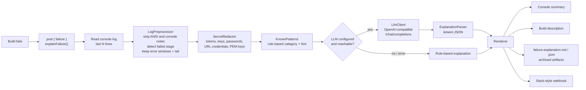

# Jenkins Failure Explainer

[](https://github.com/tanvesh1234/jenkins-failure-explainer/actions/workflows/ci.yml)


A Jenkins shared library that tells developers **why a build failed and how to fix it**, right at the
end of the console log. Add one line to a pipeline:

```groovy
post { failure { explainFailure() } }
```

When the build fails, the step reads the console log, strips noise and secrets, keeps only the lines
around the errors, and asks an LLM for the root cause. The answer appears in the console, on the build
page, as an archived report, and optionally in Slack.

It works with **any OpenAI-compatible endpoint**, so it runs on free options (Groq, Google Gemini,
OpenRouter free models) or **fully offline with Ollama**. If no LLM is configured or the call fails, a
built-in rule engine still classifies the failure, so a red build is never left unexplained.

```
========== BUILD FAILURE EXPLAINED ==========
Category   : COMPILATION_ERROR
Stage      : Build
Summary    : The code does not compile
Evidence   : [ERROR] .../InvoiceService.java:[33,22] cannot find symbol
How to fix :
  1. Fix the first compiler error shown; later ones are often caused by it.
  2. Pull the latest main branch and build locally to reproduce.
  3. Check that a dependency upgrade did not change an API you call.
Confidence : medium   Source: built-in rules
=============================================
```
*Rules-mode output on the bundled Maven sample. With an LLM configured, the summary and root cause name
the exact method, file and commit involved.*

## Why

Developers lose time on red builds scrolling through thousands of log lines, and the same handful of
causes (a broken compile, a flaky test, a dependency conflict, an out-of-memory agent) repeat across
teams. This step shortens the time from "build failed" to "I know what to fix" and gives platform teams
a consistent category for every failure, which makes recurring problems measurable.

## How it works



Design choices worth noting:

- **Only a small excerpt leaves Jenkins.** A 20 MB log becomes a few hundred lines: the regions around
  the last error lines plus the tail, capped at 12,000 characters. That keeps prompts cheap, fast, and
  inside free-tier limits.
- **Secrets are removed before anything is sent.** Jenkins already masks bound credentials; the
  redactor also catches tokens that were never bound (echoed env vars, `curl -v`, connection strings).
  The bundled `pytest-failures` sample deliberately leaks a password and a token, and the tests check
  neither reaches the prompt.
- **Rules first, LLM second.** The rule match is passed to the LLM as a hint, which improves answers
  from small models, and is used as the full answer when the LLM is unavailable.
- **One HTTP client for every provider.** Groq, Gemini, OpenRouter, Ollama and LM Studio all speak the
  OpenAI chat-completions format, so switching provider is a config change.
- **No extra plugins.** Plain `java.net` and `groovy.json`, all inside `@NonCPS` methods, so it works on
  a stock Jenkins with Pipeline installed.

## Quick start: the demo (about 5 minutes)

Needs Docker. The demo starts a pre-configured Jenkins with the library installed and seven pipelines
that fail in different ways.

```bash
git clone https://github.com/tanvesh1234/jenkins-failure-explainer.git
cd jenkins-failure-explainer
cp .env.example .env          # add a free Groq key, or skip this step for rules-only mode
docker compose up --build
```

Open http://localhost:8080 (user `admin`, password `admin`), go to the **demo** folder, and run any
job. The explanation is at the end of the console output, on the build page, and under
*Build Artifacts → failure-explanation.md*.

| Demo job | What fails | Type |
|---|---|---|
| `maven-compile-error` | A refactor removed a method that two classes still call | replayed |
| `npm-eresolve` | Peer-dependency conflict after a React upgrade | replayed |
| `pytest-failures` | Two GST rounding tests fail; the log also leaks secrets | replayed |
| `java-oom` | An integration test loads a year of rows and runs out of heap | replayed |
| `docker-daemon-down` | The agent cannot reach the Docker daemon | replayed |
| `real-missing-tool` | `kubectl` is not installed on the agent | real |
| `real-network-error` | The build calls a host that does not resolve | real |

*Replayed* jobs print a recorded failure log from `demo/logs/` inside a real `sh` step and exit with
the original exit code, so you get realistic Maven, npm, pytest and Gradle failures without installing
those toolchains. *Real* jobs fail for real.

### Running fully offline with Ollama

```bash
# in .env
LLM_BASE_URL=http://ollama:11434/v1
LLM_MODEL=qwen2.5:3b
OLLAMA_MODEL=qwen2.5:3b

docker compose --profile ollama up --build
```

The first start downloads the model (about 2 GB). No API key, and no log data leaves your machine.

## Free LLM options

| Provider | `LLM_BASE_URL` | Key | Notes |
|---|---|---|---|
| Groq | `https://api.groq.com/openai/v1` | [console.groq.com/keys](https://console.groq.com/keys) | Free tier, very fast |
| Google Gemini | `https://generativelanguage.googleapis.com/v1beta/openai` | [aistudio.google.com/apikey](https://aistudio.google.com/apikey) | Free tier |
| OpenRouter | `https://openrouter.ai/api/v1` | [openrouter.ai/keys](https://openrouter.ai/keys) | Use a model id ending in `:free` |
| Ollama | `http://ollama:11434/v1` | none | Local, private, needs about 4 GB RAM for 3B models |

Model ids and free-tier limits change often; check the provider's model list and put a current id in
`LLM_MODEL`.

## Using it in your own Jenkins

1. **Manage Jenkins → System → Global Trusted Pipeline Libraries**: add this repository with the name
   `failure-explainer` and default version `main`. It must be a *global (trusted)* library because it
   reads the build's own log.
2. **Manage Jenkins → Credentials**: add a *Secret text* credential with id `llm-api-key`.
3. **Manage Jenkins → System → Global properties → Environment variables**: set `LLM_BASE_URL` and
   `LLM_MODEL`.
4. In a pipeline:

```groovy
@Library('failure-explainer') _

pipeline {
    agent any
    stages {
        stage('Build') { steps { sh 'mvn -B verify' } }
    }
    post {
        failure { explainFailure() }
    }
}
```

The step returns a `Map` (`category`, `summary`, `rootCause`, `suggestedFixes`, `failedStage`,
`confidence`, `source`), so pipelines can act on it, for example routing `OUT_OF_MEMORY` failures to the
platform team. See [`examples/Jenkinsfile`](examples/Jenkinsfile).

### Options

| Argument | Env variable | Default | Purpose |
|---|---|---|---|
| `baseUrl` | `LLM_BASE_URL` | none | OpenAI-compatible base URL. Empty = rules only |
| `model` | `LLM_MODEL` | none | Model id at that provider |
| `credentialsId` | `LLM_CREDENTIALS_ID` | `llm-api-key` | Secret-text credential with the API key. `null` for Ollama |
| `maxLogLines` | | `5000` | Lines read from the end of the log |
| `webhookCredentialsId` | | none | Secret-text credential holding a Slack-compatible webhook URL |
| `webhookUrl` | `EXPLAINER_WEBHOOK_URL` | none | Same, as a plain URL |
| `archive` | | `true` | Archive `failure-explanation.md` and `.json` |
| `setDescription` | | `true` | Put the one-line summary on the build page |
| `failOnError` | | `false` | Rethrow if the step itself breaks |

## Try it on any log, without Jenkins

```bash
./gradlew explain --args="demo/logs/java-oom.log"            # rules only
export LLM_BASE_URL=https://api.groq.com/openai/v1 LLM_MODEL=llama-3.1-8b-instant LLM_API_KEY=gsk_...
./gradlew explain --args="--markdown path/to/your-build.log" # with an LLM
```

Save a console log from your own Jenkins (`<build-url>/consoleText`) and run it through.

## Tests

```bash
./gradlew test
```

34 unit tests cover redaction, log trimming and stage detection on all sample logs, rule
classification across Java, Node, Python, Go and TypeScript errors, lenient parsing of messy LLM
replies, fallback when the LLM is down or returns junk, and the HTTP client against a local fake
OpenAI-compatible server (auth header, JSON mode, retry without JSON mode on HTTP 400).

CI also boots the demo Jenkins in Docker and runs [`docker/smoke-test.sh`](docker/smoke-test.sh), which
triggers demo jobs through the REST API and checks the explanation reached the build page.

## Project structure

```
vars/explainFailure.groovy        pipeline step (Jenkins-facing glue)
src/io/github/tanvesh/explainer/
  LogPreprocessor.groovy          clean, trim, detect failed stage
  SecretRedactor.groovy           remove secrets before anything leaves Jenkins
  KnownPatterns.groovy            offline rule engine (12 failure categories)
  PromptBuilder.groovy            system prompt + JSON output contract
  LlmClient.groovy                OpenAI-compatible HTTP client
  ExplanationParser.groovy        lenient JSON parsing of model replies
  Explainer.groovy                orchestration and fallback
  Renderer.groovy                 console, Markdown, JSON, webhook formats
test/                             JUnit tests
stubs/                            @NonCPS stand-in so tests run outside Jenkins
cli/ExplainLog.groovy             local runner (./gradlew explain)
demo/logs/                        realistic failure logs used by tests and demo jobs
docker/                           demo Jenkins image, JCasC, Job DSL, smoke test
```

## Security notes

- Load it as a **trusted** global library only from a repository you control: trusted libraries run
  outside the Groovy sandbox.
- Redaction is pattern-based and cannot catch every possible secret format. For sensitive projects use
  Ollama so logs never leave your network.
- The API key is read through `withCredentials`, so Jenkins masks it in the console.

## Roadmap

- Create a ServiceNow incident (or Jira ticket) for repeated failures in the same category
- Comment the explanation on the GitHub pull request that triggered the build
- Cache explanations by log fingerprint so identical failures cost no extra LLM calls
- Weekly report of failure categories per team to show where build time is lost

## License

MIT
